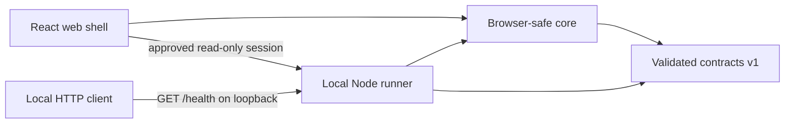

# OrbiGuild

**Stage 01 / Secure local connection**

OrbiGuild is a new, public, MIT-licensed project for a web interface where people
will create AI agents and observe real work in an interactive office. A separately
controlled Local Runner will execute approved tasks on the user's own machine.
Cloud storage will not mean cloud execution.

Stage 01 adds explicit terminal-approved pairing between the local React/Vite app
and Node Runner. A memory-only session grants read-only status for 15 minutes.
There is no agent execution, provider integration, database or office simulation.
No provider API key or account is needed.

## Get started

Use **Node.js 24 LTS** (24.19.0 or later within major 24) and **npm 11**
(11.9.0 or later within major 11). The pinned reference versions are Node
**24.19.0** and npm **11.9.0**; see [development and verification](docs/DEVELOPMENT.md).

```sh
git clone https://github.com/Bekzhanizb/OrbiGuild.git
cd OrbiGuild
npm ci
npm run dev
```

Open **http://127.0.0.1:5173** and choose **Pair with runner**. Compare the public
verification code in the browser with the runner terminal, then type `approve CODE`
in that terminal only if they match. The page shows **Connected** only after a real
authenticated status check. **Disconnect** revokes the session; terminal `revoke`
revokes all connections. See [pairing and recovery](docs/LOCAL_CONNECTION.md).

The separate CLI health endpoint is **http://127.0.0.1:4319/health**. Its original
foundation response remains compatible and does not indicate pairing or execution.
Stop both processes with Ctrl+C. Ports fail closed if already in use.

```sh
curl --fail http://127.0.0.1:4319/health
npm run check
```

On Windows PowerShell, use `curl.exe` for the health command. A successful health
response describes only an idle process with zero connected agents:

```json
{"service":"orbiguild-runner","protocolVersion":1,"status":"ok","runner":{"stage":"foundation","state":"idle","connectedAgents":0}}
```

| Command | Purpose |
| --- | --- |
| `npm ci` | Install exactly the committed root lockfile |
| `npm run dev` | Build shared packages, then start the local web shell and runner |
| `npm run typecheck` | Check every workspace and its tests |
| `npm run lint` | Check TypeScript and JavaScript with ESLint |
| `npm test` | Run behavior tests, including real loopback HTTP requests |
| `npm run build` | Build shared libraries, runner and static web assets |
| `npm run docs:check` | Check basic Markdown structure and local links/anchors |
| `npm run check` | Run lint, typecheck, tests, build and documentation checks |

## Architecture



[ADR 0002](docs/adr/0002-secure-local-pairing.md) defines local pairing, expiration,
revocation and the security boundaries. Hosted browser access remains deferred.

| Workspace | Current responsibility |
| --- | --- |
| `apps/web` | Accessible real connection lifecycle and memory-only session |
| `apps/runner` | Loopback health, terminal approval and authenticated read-only status |
| `packages/contracts` | Strict versioned health, pairing and status schemas |
| `packages/core` | Pure status helpers and connection labels |

The runner binds only literal loopback addresses. It verifies Host and Origin,
limits request bodies/time/rate, and grants CORS only to the supported local origin.
The legacy health endpoint keeps its browser rejection policy. No execution-capable
endpoint exists. See [security](docs/SECURITY.md).

## Current scope and roadmap

SQLite is the planned zero-configuration default for the initial useful release.
The maintainer-preferred cloud option is a user-owned Supabase project with a
publishable key, end-user Auth and RLS. Privileged keys never belong in the browser
or runner. Neither database is implemented or connected in Stage 01. Other SQL
databases and providers are future work.

The [product definition](docs/PRODUCT.md) and [roadmap](docs/ROADMAP.md) keep the
foundation separate from future agent execution, permissions, durable events,
and the read-only office renderer. The target layout is intentionally larger
than the four packages created today.

## Contribute and report issues

Read [CONTRIBUTING.md](CONTRIBUTING.md), [AGENTS.md](AGENTS.md) and the
[development guide](docs/DEVELOPMENT.md). Small, reviewable changes are welcome.
Report vulnerabilities privately using [SECURITY.md](SECURITY.md), rather than
posting credentials or exploit details in an issue.

Public screenshots and recordings must follow the [demo policy](docs/DEMO_POLICY.md):
show actual behavior, or visibly label fixture-based demonstrations. Stage 01 has
no demo agents or simulated successful work.

This repository has its own history. No AgentNest source, assets or history are
imported, and that repository must remain unchanged. Only
[documented conceptual lessons](docs/ARCHITECTURE.md#agentnest-conceptual-reuse)
may inform later designs, subject to independent implementation and license review.

Licensed under the existing [MIT license](LICENSE).

Suggested repository description: **Web-first AI agent workspace with a separately
controlled local runner. Stage 01 secure local connection.**

Suggested topics: `orbiguild`, `ai-agents`, `local-first`, `typescript`, `react`,
`vite`, `npm-workspaces`, `open-source`. Topics describe direction, not completed
integrations. See [GitHub setup](docs/GITHUB.md) for publication and protection steps.
