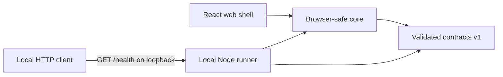

# OrbiGuild

**Foundation / No connected agents**

OrbiGuild is a new, public, MIT-licensed project for a web interface where people
will create AI agents and observe real work in an interactive office. A separately
controlled Local Runner will execute approved tasks on the user's own machine.
Cloud storage will not mean cloud execution.

Stage 00 implements a small foundation: a React/Vite shell, a read-only loopback
runner health endpoint, validated shared contracts, tests, and CI configuration.
There is no agent connection, task execution, provider integration, database,
authentication, pairing, or office simulation yet. No API key or account is needed.

## Get started

Use **Node.js 24 LTS** (24.19.0 or later within major 24) and **npm 11**
(11.9.0 or later within major 11). The pinned reference versions are Node
**24.19.0** and npm **11.9.0**; see [development and verification](docs/DEVELOPMENT.md).

```sh
git clone https://github.com/Bekzhanizb/OrbiGuild.git
cd OrbiGuild
npm ci
npm run dev
```

Open **http://127.0.0.1:5173**. The page truthfully displays
**Foundation / No connected agents**. The runner listens on
**http://127.0.0.1:4319/health**. These processes are separate; the page does not
contact the runner. Stop both with Ctrl+C. Ports fail closed if already in use.

```sh
curl --fail http://127.0.0.1:4319/health
npm run check
```

On Windows PowerShell, use `curl.exe` for the health command. A successful health
response describes only an idle process with zero connected agents:

```json
{"service":"orbiguild-runner","protocolVersion":1,"status":"ok","runner":{"stage":"foundation","state":"idle","connectedAgents":0}}
```

| Command | Purpose |
| --- | --- |
| `npm ci` | Install exactly the committed root lockfile |
| `npm run dev` | Build shared packages, then start the local web shell and runner |
| `npm run typecheck` | Check every workspace and its tests |
| `npm run lint` | Check TypeScript and JavaScript with ESLint |
| `npm test` | Run behavior tests, including real loopback HTTP requests |
| `npm run build` | Build shared libraries, runner and static web assets |
| `npm run docs:check` | Check basic Markdown structure and local links/anchors |
| `npm run check` | Run lint, typecheck, tests, build and documentation checks |

## Architecture



There is deliberately no browser-to-runner connection in stage 00. The
[architecture](docs/ARCHITECTURE.md) describes the future event flow and the
[transport ADR](docs/adr/0001-local-first-web-and-runner.md) records the security
conditions required before connecting them.

| Workspace | Current responsibility |
| --- | --- |
| `apps/web` | Accessible, static foundation screen; no Node imports or secrets |
| `apps/runner` | Validated startup options and restricted read-only health API |
| `packages/contracts` | Strict, versioned runner health/status schemas |
| `packages/core` | Pure foundation status creation and presentation |

The runner accepts only literal `127.0.0.1` or `::1` bind addresses. It verifies
the exact Host authority, rejects browser-origin requests, accepts no payloads,
and sends no CORS grants. It has no command API. Loopback is not authentication;
the current surface is suitable only for local health checks. See the
[security model](docs/SECURITY.md) and [runner configuration](docs/DEVELOPMENT.md).

## Current scope and roadmap

SQLite is the planned zero-configuration default for the initial useful release.
The maintainer-preferred cloud option is a user-owned Supabase project with a
publishable key, end-user Auth and RLS. Privileged keys never belong in the browser
or runner. Neither database is implemented or connected in stage 00. Other SQL
databases and providers are future work.

The [product definition](docs/PRODUCT.md) and [roadmap](docs/ROADMAP.md) keep the
foundation separate from future agent execution, permissions, durable events,
and the read-only office renderer. The target layout is intentionally larger
than the four packages created today.

## Contribute and report issues

Read [CONTRIBUTING.md](CONTRIBUTING.md), [AGENTS.md](AGENTS.md) and the
[development guide](docs/DEVELOPMENT.md). Small, reviewable changes are welcome.
Report vulnerabilities privately using [SECURITY.md](SECURITY.md), rather than
posting credentials or exploit details in an issue.

Public screenshots and recordings must follow the [demo policy](docs/DEMO_POLICY.md):
show actual behavior, or visibly label fixture-based demonstrations. Stage 00 has
no demo agents or simulated successful work.

This repository has its own history. No AgentNest source, assets or history are
imported, and that repository must remain unchanged. Only
[documented conceptual lessons](docs/ARCHITECTURE.md#agentnest-conceptual-reuse)
may inform later designs, subject to independent implementation and license review.

Licensed under the existing [MIT license](LICENSE).

Suggested repository description: **Web-first AI agent workspace with a separately
controlled local runner. Stage 00 foundation.**

Suggested topics: `orbiguild`, `ai-agents`, `local-first`, `typescript`, `react`,
`vite`, `npm-workspaces`, `open-source`. Topics describe direction, not completed
integrations. See [GitHub setup](docs/GITHUB.md) for publication and protection steps.
