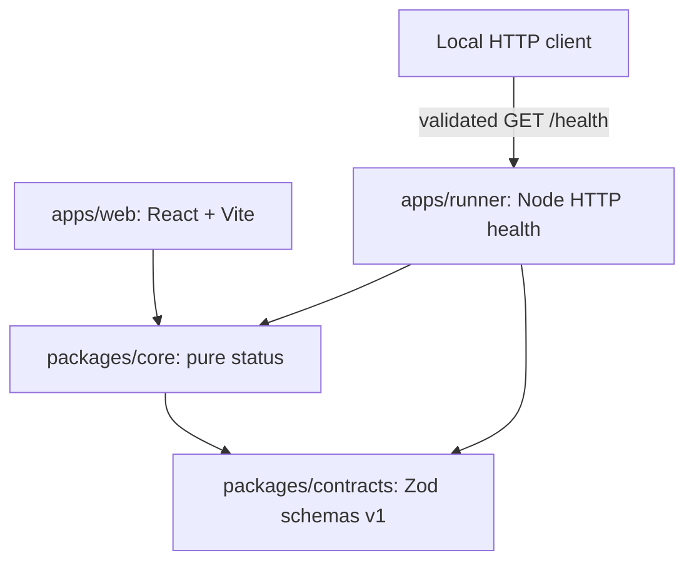
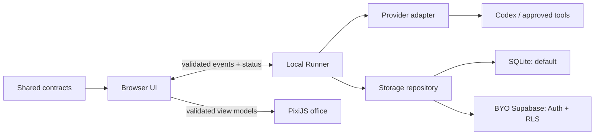

# Architecture

Read the [product definition](PRODUCT.md) and
[ADR 0001](adr/0001-local-first-web-and-runner.md) before adding functionality.

## Current foundation

The npm monorepo has four workspaces. `contracts` is a browser-safe Zod schema
package. `core` contains pure status creation and presentation. The web shell
imports core without Node APIs. The Node runner imports core and contracts and
exposes read-only health. No runtime connection exists between the web and runner.



Shared packages publish only to local `dist` folders; npm packages are private.
Build order is contracts, core, runner, web. Development rebuilds shared packages
at startup. There is no generic plugin loader, database selector or orchestration
framework. Runtime boundaries take unknown input and validate it before use.

## Target layout

```text
OrbiGuild/
  apps/
    web/                 React, Vite, TypeScript
    runner/              local Node runtime and transport boundary
  packages/
    contracts/           versioned schemas and input/event validation
    core/                pure agent, task, run and permission logic later
    office/              future PixiJS read-only event projector
    ui/                  future shared React primitives when consumers need them
    providers/           future adapter contract; Codex adapter later
    storage/             future SQLite baseline and BYO Supabase repositories
  examples/              documentation now; agent definitions later
  docs/adr/              architecture decisions
  prompts/               bounded implementation briefs
  .github/               CI, dependency hygiene, issue and PR templates
```

Only contracts and core are package workspaces in stage 00. The future packages
will be introduced with concrete consumers, tests and build scripts. There are no
empty packages implying that these integrations already work.

## Target data flow (not implemented)



The browser/runner arrow is a future authenticated transport, not a current
localhost fetch. The runner alone will access filesystem, Git, commands and
provider credentials. Provider adapters will expose start, cancel, event streaming
and approval requests; callers must check each provider's capabilities. The office
will deterministically render validated events or visibly labelled demo events,
and will never originate execution events.

## Transport boundary

Stage 00 provides only `GET /health`. Startup accepts literal `127.0.0.1` or `::1`
and a validated port; no DNS resolution or wildcard binding is allowed. Requests
must come from loopback, use the exact configured Host authority and contain no
Origin or Fetch Metadata headers. Payloads and query strings are rejected. The
server does not grant CORS or accept arbitrary commands.

This unauthenticated, read-only health surface is not a secure execution channel.
A later local MVP may accompany or serve a localhost web app with authenticated,
narrow APIs, strict Origin/Host checks and CSRF protection. Binding to loopback
alone does not stop malicious websites or other local processes. Hosted HTTPS UI
to HTTP localhost is deferred: browser secure-context, local-network access,
mixed-content and DNS-rebinding behavior vary. Future hosted use needs explicit
user pairing over an outbound TLS connection/relay, short-lived credentials,
revocation, consent and workspace scoping. See the ADR for the decision gate.

## Persistence decision

No driver, schema, migration, project or database is created in stage 00.

SQLite is the future zero-configuration baseline. The runner owns the local file,
migrations and backups. The maintainer-preferred optional cloud mode is a user-owned
Supabase project, using a publishable key plus end-user Auth and RLS. A publishable
key identifies a project and does not replace authorization. Every exposed table
needs RLS and ownership/membership policies tested for cross-user isolation;
updates need both visibility and write checks.

No secret key, service-role key or privileged database credential belongs in the
public client or runner. A future repository API can hide engine details, but
Supabase Auth/RLS and direct SQL credentials require separate security models.
Direct PostgreSQL and MySQL via least-privilege credentials are later work.
User-approved definitions, metadata and task summaries may be stored in Supabase;
raw secrets and arbitrary code/output are excluded by default. Cloud storage does
not authorize cloud execution or automatic uploads.

Reference guidance: [Supabase API keys](https://supabase.com/docs/guides/api/api-keys)
and [row-level security](https://supabase.com/docs/guides/database/postgres/row-level-security).

## AgentNest conceptual reuse

AgentNest is a separate project and is not inspected, modified, renamed, archived,
deleted or imported in this stage. OrbiGuild's existing independent GitHub history
is retained. No AgentNest source, history, assets or Electron-only code is copied.

The following are candidate concepts only, not claims about reviewed AgentNest
implementation: agent/task/run vocabulary, provider-boundary separation,
permission and approval flows, append-only event thinking, office projection and
storage repository boundaries. Any later reuse needs an independent design,
license/provenance review and explicit scope. Electron main/preload processes,
desktop IPC bridges, native window lifecycle and bundled credentials are not part
of the web-first foundation.
